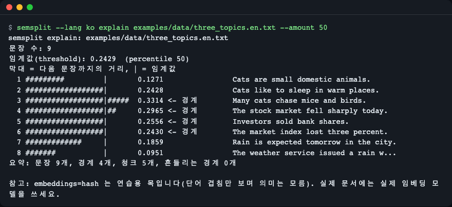
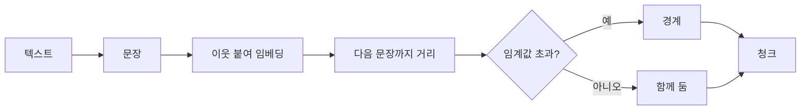
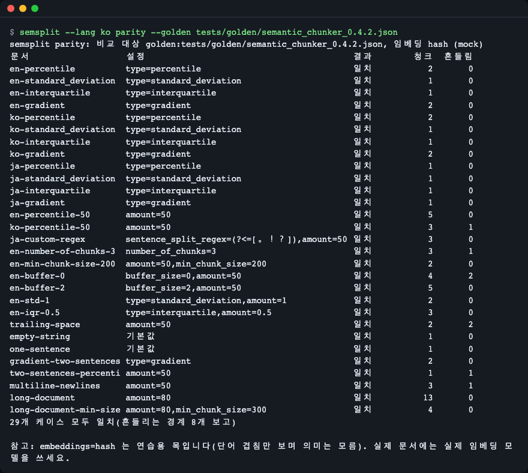
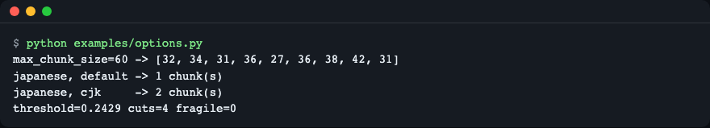
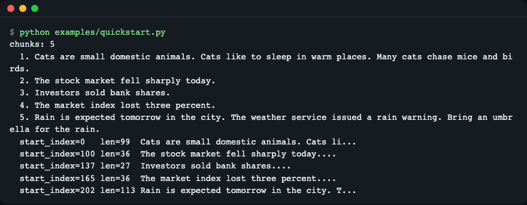

# semsplit

[English](README.md) | **한국어**

RAG용 의미 기반 청킹 라이브러리입니다. 보관 종료된 `langchain-experimental` 의 `SemanticChunker` 를 대신하는 독립 재구현으로, 기본 인자에서는 같은 청크를 내고 그 약속을 원본 또는 기록해 둔 출력과 직접 비교하는 parity 명령을 함께 줍니다. 런타임 의존성은 `langchain-core` 와 `numpy` 뿐이며, 최대 청크 크기 보장, 정확한 `start_index` 를 가진 원문 슬라이스, 일본어·중국어 문장 분리, 임베딩 배치를 옵션으로 켤 수 있습니다.



*`semsplit explain` 은 다음 문장까지의 거리를 막대로, 임계값을 `|` 로, 모든 경계를 표시합니다.*

## 설치

```bash
pip install semsplit
# uv 를 쓴다면
uv add semsplit
# GitHub 에서 바로
uv add git+https://github.com/LeeGyeongPil/semsplit
```

Python 3.10 이상. 런타임 의존성은 `langchain-core`(1.x)와 `numpy` 두 개입니다. 그 밖의 것은 불러오지 않으므로 `langchain_community`·`langchain_experimental` 도 끌려오지 않습니다.

uv 가 없다면 `curl -LsSf https://astral.sh/uv/install.sh | sh` ([문서](https://docs.astral.sh/uv/)). 원본과의 비교(parity)에는 extra 가 필요합니다: `pip install "semsplit[legacy]"`.

## 빠르게 시작하기

`langchain-experimental` 에서 옮기려면 한 줄만 바꿉니다.

```diff
- from langchain_experimental.text_splitter import SemanticChunker
+ from semsplit import SemanticChunker
```

바로 실행되는 예제입니다(`HashEmbeddings` 는 오프라인 연습용 목이며 아래에 설명합니다). 예제 파일은 레포에 들어 있으므로 이 레포의 clone(`git clone https://github.com/LeeGyeongPil/semsplit`)에서 실행하세요. pip 로만 설치했다면 내 텍스트 파일을 읽으면 됩니다.

```python
from semsplit import HashEmbeddings, SemanticChunker

text = open("examples/data/three_topics.en.txt", encoding="utf-8").read()
chunker = SemanticChunker(HashEmbeddings(), breakpoint_threshold_amount=50)
for i, chunk in enumerate(chunker.split_text(text), start=1):
    print(i, chunk[:50])
```

```text
1 Cats are small domestic animals. Cats like to slee
2 The stock market fell sharply today.
3 Investors sold bank shares.
4 The market index lost three percent.
5 Rain is expected tomorrow in the city. The weather
```

연습용 목(mock) 모드입니다. `HashEmbeddings` 는 의미가 아니라 단어 겹침만 보므로 키도 네트워크도 필요 없습니다. 실제 문서에는 LangChain `Embeddings` 객체(OpenAI, Ollama, HuggingFace 등)를 넘기세요. CLI 는 `--embeddings ollama:<모델>` 로 로컬 Ollama 모델도 쓸 수 있습니다(`OLLAMA_HOST` 사용, 기본 `http://localhost:11434`). 이 경로는 로컬 가짜 서버로만 시험했고, 실제 모델은 더 느릴 수 있습니다.

## 핵심 개념

1. **문장 사이 거리.** 텍스트를 문장으로 나누고, 문장마다 (`buffer_size` 만큼의 양옆 이웃을 붙여) 임베딩한 뒤 다음 문장과의 코사인 거리를 구합니다.
2. **임계값.** `breakpoint_threshold_type`(`percentile`, `standard_deviation`, `interquartile`, `gradient`)과 `breakpoint_threshold_amount` 로 정한 임계값보다 거리가 큰 곳에서 자릅니다.
3. **흔들리는 경계.** 거리가 임계값과 거의 같은 곳입니다. 아주 작은 수치 차이로 뒤집힐 수 있어서 `semsplit` 이 따로 알려 줍니다(`--eps` 로 "거의"의 폭을 정합니다).
4. **Parity.** 옛 코드와 새 코드에 같은 벡터를 먹이므로, 차이가 있다면 임베딩 백엔드가 아니라 분리 코드의 차이입니다.



상자 하나가 `split_text` 의 한 단계입니다: 문장 분리, 임베딩, 거리 계산, 임계값 비교, 자르지 않은 부분 합치기.

## 사용법

### 명령줄

```bash
uv run semsplit --lang ko explain examples/data/three_topics.en.txt --amount 50
```

```text
참고: embeddings=hash 는 연습용 목입니다(단어 겹침만 보며 의미는 모름). 실제 문서에는 실제 임베딩 모델을 쓰세요.
semsplit explain: examples/data/three_topics.en.txt
문장 수: 9
임계값(threshold): 0.2429  (percentile 50)
막대 = 다음 문장까지의 거리, | = 임계값
  1 #########         |       0.1271                Cats are small domestic animals.
  2 ##################|       0.2428                Cats like to sleep in warm places.
  3 ##################|#####  0.3314 <- 경계        Many cats chase mice and birds.
  4 ##################|##     0.2965 <- 경계        The stock market fell sharply today.
  5 ##################|       0.2556 <- 경계        Investors sold bank shares.
  6 ##################|       0.2430 <- 경계        The market index lost three percent.
  7 #############     |       0.1859                Rain is expected tomorrow in the city.
  8 #######           |       0.0951                The weather service issued a rain w...
요약: 문장 9개, 경계 4개, 청크 5개, 흔들리는 경계 0개
```

2번 문장의 거리는 0.2428, 임계값은 0.2429 입니다. 임계값을 조절할 때 눈여겨볼 값이 바로 이런 것입니다. 청크 수는 항상 경계 수 + 1 입니다.

`semsplit split FILE` 은 청크마다 JSON 한 줄(`source`, `chunk`, `start_index`, `text`)을 출력합니다.

```bash
uv run semsplit --lang ko split examples/data/ja.txt --sentence-split cjk --amount 50
```

```text
참고: embeddings=hash 는 연습용 목입니다(단어 겹침만 보며 의미는 모름). 실제 문서에는 실제 임베딩 모델을 쓰세요.
{"source": "examples/data/ja.txt", "chunk": 0, "start_index": 0, "text": "猫は小さな動物です。猫は暖かい場所で寝ます。"}
{"source": "examples/data/ja.txt", "chunk": 1, "start_index": 22, "text": "今日、株式市場が下落しました。投資家は銀行株を売りました。"}
```

(일본어 예문의 뜻: "고양이는 작은 동물입니다. 고양이는 따뜻한 곳에서 잡니다." / "오늘 주식 시장이 하락했습니다. 투자자는 은행 주식을 팔았습니다.")

기본값에서 `start_index` 는 원본의 값(앞선 청크 길이의 합)을 그대로 재현하므로 실제 위치와 한두 글자 어긋날 수 있습니다. 파일 안의 정확한 위치가 필요하면 `--text-mode original` 을 주세요. 비어 있거나 공백뿐인 파일은 청크 없이 stderr 에 한 줄 안내만 출력합니다.

화면 언어: `--lang en|ko`, 그다음 `SEMSPLIT_LANG`, 그다음 `LC_ALL`·`LC_MESSAGES`·`LANG` 순입니다(한국어가 아니면 영어).

### 같은 청크가 나오는지 확인하기(parity)

```bash
uv run semsplit --lang ko parity --golden tests/golden/semantic_chunker_0.4.2.json
```

```text
참고: embeddings=hash 는 연습용 목입니다(단어 겹침만 보며 의미는 모름). 실제 문서에는 실제 임베딩 모델을 쓰세요.
semsplit parity: 비교 대상 golden:tests/golden/semantic_chunker_0.4.2.json, 임베딩 hash (mock)
문서                   설정                                         결과        청크  흔들림
en-percentile          type=percentile                              일치           2       0
en-standard_deviation  type=standard_deviation                      일치           1       0
...
long-document-min-size amount=80,min_chunk_size=300                 일치           4       0
29개 케이스 모두 일치(흔들리는 경계 8개 보고)
```

29개 케이스(영어·한국어·일본어, 임계값 4종, 빈 문자열·끝 공백 같은 경계 사례)는 `langchain-experimental` 0.4.2 에서 기록한 것이며 바이트 단위로 비교합니다. 내 파일로 원본과 실시간 비교하려면 extra 를 설치하세요.

```bash
uv run --extra legacy semsplit --lang ko parity examples/data/three_topics.en.txt examples/data/ko.txt --against legacy --embeddings hash --amount 50
```

```text
참고: embeddings=hash 는 연습용 목입니다(단어 겹침만 보며 의미는 모름). 실제 문서에는 실제 임베딩 모델을 쓰세요.
semsplit parity: 비교 대상 legacy, 임베딩 hash (mock)
문서                   설정                                         결과        청크  흔들림
three_topics.en.txt    amount=50.0                                  일치           5       0
ko.txt                 amount=50.0                                  일치           3       1
2개 케이스 모두 일치(흔들리는 경계 1개 보고)
```

종료 코드: 0 성공·일치, 1 불일치(달라진 경계 위치를 출력), 2 사용법·설정 오류(예: 잘못된 `--threshold`), 3 `legacy` extra 미설치, 4 임베딩 백엔드 연결 실패. `--json` 은 기계가 읽는 보고서, `--record FILE` 은 직접 만든 골든 파일을 씁니다.



*기록된 케이스가 모두 일치합니다.*

### 옵션(켜야만 동작이 바뀝니다)

기본값은 원본의 특이한 동작까지 그대로 재현합니다. 아래 옵션은 켤 때만 출력이 달라집니다(`examples/options.py`).

```python
from semsplit import HashEmbeddings, SemanticChunker, analyze

# 1. 크기 상한: 모든 청크가 60자 이하(임베딩 호출은 늘지 않음).
sized = SemanticChunker(HashEmbeddings(), breakpoint_threshold_amount=50, max_chunk_size=60)

# 2. 일본어는 문장 사이에 공백이 없습니다: sentence_split="cjk" 는 。！？ 에서 나눕니다.
cjk = SemanticChunker(HashEmbeddings(), breakpoint_threshold_amount=50, sentence_split="cjk")

# 3. 안쪽 들여다보기: 거리, 임계값, 흔들리는 경계.
info = analyze(text, HashEmbeddings(), breakpoint_threshold_amount=50)
```

```bash
uv run python examples/options.py
```

```text
max_chunk_size=60 -> [32, 34, 31, 36, 27, 36, 38, 42, 31]
japanese, default -> 1 chunk(s)
japanese, cjk     -> 2 chunk(s)
threshold=0.2429 cuts=4 fragile=0
```



*예제 파일에 크기 상한, CJK 분리, `analyze` 를 적용한 결과입니다.*

원문 슬라이스와 정확한 `start_index` (`examples/quickstart.py`):

```bash
uv run python examples/quickstart.py
```

```text
chunks: 5
  1. Cats are small domestic animals. Cats like to sleep in warm places. Many cats chase mice and birds.
  2. The stock market fell sharply today.
  3. Investors sold bank shares.
  4. The market index lost three percent.
  5. Rain is expected tomorrow in the city. The weather service issued a rain warning. Bring an umbrella for the rain.
  start_index=0   len=99  Cats are small domestic animals. Cats li...
  start_index=100 len=36  The stock market fell sharply today....
  start_index=137 len=27  Investors sold bank shares....
  start_index=165 len=36  The market index lost three percent....
  start_index=202 len=113 Rain is expected tomorrow in the city. T...
```



*청크 5개, 그다음 `text_mode="original"`·`max_chunk_size=120` 으로 나눈 결과입니다. 스크립트가 `text[start:start+len] == chunk` 를 검증합니다.*

## API

| 이름 | 하는 일 | 주요 인자 | 반환 |
|---|---|---|---|
| `SemanticChunker` | 임베딩 거리가 큰 곳에서 텍스트를 나눕니다. LangChain `BaseDocumentTransformer` | `embeddings`, `buffer_size=1`, `add_start_index=False`, `breakpoint_threshold_type="percentile"`, `breakpoint_threshold_amount`, `number_of_chunks`, `sentence_split_regex`, `min_chunk_size`; 키워드 전용: `max_chunk_size`, `length_function=len`, `text_mode`, `sentence_split="default"`, `embed_batch_size` | 인스턴스 |
| `.split_text(text)` | 청크를 문자열로 | `text: str` | `list[str]` |
| `.create_documents(texts, metadatas=None)` | 청크를 `Document` 로(켜면 `start_index` 포함) | `texts: list[str]` | `list[Document]` |
| `.split_documents(docs)` / `.transform_documents(docs)` | `Document` 입력용 | `docs` | `list[Document]` / `Sequence[Document]` |
| `.analyze(text, eps=1e-9)` | 청크를 만들지 않고 거리와 경계만 계산 | `text`, `eps` | `Analysis` |
| `analyze(text, embeddings, *, eps=1e-9, **options)` | 위와 같은 일을 함수 한 번으로 | 청커 옵션 | `Analysis` (`sentences`, `distances`, `threshold`, `breakpoints`, `fragile`, `chunk_count`) |
| `check_parity(texts, embeddings=None, configs=None, *, against="legacy", eps=1e-9)` | 원본(`legacy` extra 필요) 또는 골든 파일 경로와 비교 | 왼쪽 참고 | `ParityReport` (`all_equal`, `to_dict()`) |
| `record_golden(texts, path, embeddings=None, configs=None, *, embeddings_name="hash", source="legacy")` | 골든 파일 쓰기 | 왼쪽 참고 | `dict` |
| `HashEmbeddings(dim=256)` | 오프라인 연습용 목(단어 겹침, 의미는 모름) | `dim` | `Embeddings` |
| `ReplayEmbeddings(inner)` | 같은 텍스트는 한 번만 임베딩하고 재사용 | `inner` | `Embeddings` |
| `OllamaEmbeddings(model, host, timeout)` | 선택 사항인 로컬 Ollama 백엔드 | `model`, `host="http://localhost:11434"` | `Embeddings` |
| `BreakpointThresholdType` | 임계값 방식 네 가지의 타입 | | `Literal` |

예외는 모두 `SemsplitError` 의 하위 클래스입니다: `InvalidConfigError`(잘못된 인자), `LegacyNotInstalledError`(extra 없이 parity), `EmbeddingBackendError`(백엔드 연결 실패).

옵션 요약:

- `text_mode`: `"legacy"` 는 문장을 공백 하나로 이어 붙입니다(옛 동작, 기본 분리기의 기본값). `"original"` 은 원문 슬라이스를 그대로 돌려주고, 줄바꿈을 보존하며, 빈 청크를 만들지 않고, 마지막 청크에도 `min_chunk_size` 를 적용합니다. `None`(기본)은 `sentence_split` 이 `"default"` 가 아니면 `"original"` 을 고릅니다.
- `max_chunk_size` 는 `length_function`(기본 `len`, 단어 수 함수도 가능)으로 잽니다. 너무 긴 청크는 그 안에서 거리가 가장 큰 곳에서 다시 자르고, 한도보다 긴 한 문장도 자릅니다.
- `sentence_split`: `"default"`, `"cjk"`, 또는 `text -> [(start, end), ...]` 콜백.
- `embed_batch_size`: `embed_documents` 를 한 번에 이 개수 이하의 텍스트로 호출합니다.

## 언제 쓰나

- 이럴 때: 이미 `langchain-experimental` 의 `SemanticChunker` 에 의존하고 있어 그 패키지 없이 같은 청크를 원할 때, 또는 크기 상한·정확한 오프셋·일본어·중국어 문장 분리가 필요할 때.
- 이럴 땐 다른 도구: 고정 크기·구조 기반 분리는 [langchain-text-splitters](https://github.com/langchain-ai/langchain/tree/master/libs/text-splitters), 원본 구현은 [langchain-experimental](https://github.com/langchain-ai/langchain-experimental)(보관 종료).
- 범위: `semsplit` 은 텍스트 하나를 나누는 일만 합니다. 벡터 저장이나 검색은 하지 않습니다.

### Chonkie·LlamaIndex 와 비교

2026-11-19 에 각 프로젝트의 공식 페이지에서 확인한 내용입니다: [Chonkie 문서](https://docs.chonkie.ai/oss/chunkers/semantic-chunker), [LlamaIndex 노드 파서](https://developers.llamaindex.ai/python/framework/module_guides/loading/node_parsers/modules/), [semchunk](https://github.com/isaacus-dev/semchunk), [semantic-text-splitter](https://github.com/benbrandt/text-splitter).

- **Chonkie `SemanticChunker`** 는 고정 유사도 임계값과 Savitzky-Golay 평활, 토큰 기준 `chunk_size`, 자체 청크·임베딩 인터페이스를 씁니다. 이미 Chonkie 를 쓰거나 토큰 크기 청크가 바로 필요하면 이쪽이 낫습니다. 알고리즘이 LangChain 쪽과 달라 옛 `SemanticChunker` 출력을 재현할 수 없고, 그 경우를 위해 `semsplit` 이 있습니다.
- **LlamaIndex `SemanticSplitterNodeParser`** 는 같은 백분위 방식이지만 LlamaIndex `Node` 를 돌려주고, 최대 크기가 없으며, 문장 분리 정규식은 주로 영어용이라고 문서에 적혀 있습니다. LlamaIndex 파이프라인 안에서는 이쪽을 고르세요.
- **semchunk·semantic-text-splitter** 는 이름에 "semantic" 이 있지만 임베딩 없이 토큰 한도 안에서 구조(문단·문장)로 나눕니다. 크기 상한만 필요하고 의미 기반 경계가 필요 없다면 이쪽이 맞습니다.

## 한계

- `HashEmbeddings` 는 의미가 아니라 단어 겹침만 셉니다. 연습과 테스트용입니다.
- Ollama 경로(`--embeddings ollama:<모델>`)는 로컬 가짜 서버로만 시험했고 실제 모델은 평가하지 않았습니다.
- `SemanticChunker` 는 LangChain `BaseDocumentTransformer` 이며 `TextSplitter` 의 하위 클래스가 아니어서 `chunk_size` 인자나 `TextSplitter` 도우미가 없습니다.
- 네이티브 async 는 없습니다. `atransform_documents` 는 동기 경로를 executor 에서 실행합니다. 진짜 비동기 임베딩은 아직 구현하지 않았습니다.
- `text_mode="original"` 은 글자 위치가 필요해서 `_get_single_sentences_list` 를 서브클래스에서 덮어쓴 것을 무시합니다.
- `number_of_chunks` 가 거리 개수와 같으면 원본의 동작을 따라 요청보다 경계가 하나 적게 나옵니다.
- 거리가 한쪽 끝으로 단조 증가하는 드문 경우에는 `max_chunk_size` 재분할이 여전히 느릴 수 있습니다.
- argparse 자체 메시지는 `--lang` 이 아니라 Python 로캘을 따릅니다.
- 원본 패키지의 출력은 임계값 근처에서 달라질 수 있습니다. 원본은 코사인 유사도를 `langchain_community` 로 계산하는데, `simsimd` 가 설치돼 있으면 float32 경로를 탑니다. `semsplit` 은 항상 float64 `numpy` 를 씁니다. 거리가 임계값에서 `--eps` 이내인 경계(흔들림 열)는 뒤집힐 수 있습니다. 내 파일로 `semsplit parity --against legacy` 를 돌려 그 열을 확인하세요.

## 문제 해결

- **`parity --against legacy` 가 종료 코드 3 으로 끝남.** 원본 패키지가 설치돼 있지 않습니다. `uv run --extra legacy ...` 또는 `pip install "semsplit[legacy]"` 로 실행하세요.
- **임계값이 무시되는 것 같음.** `number_of_chunks` 가 임계값 방식보다 우선합니다. 값이 거리 개수와 같으면 원본의 동작을 따라 요청보다 경계가 하나 적게 나옵니다.
- **전부 한 청크가 됨.** 예제 문서처럼 문장이 적으면 기본 percentile 95 에서는 거의 자르지 않습니다. `--amount 50` 으로 `explain` 을 보며 조절하세요.
- **argparse 메시지가 번역되지 않음.** argparse 자체 메시지는 `--lang` 이 아니라 Python 로캘을 따릅니다.

## 버전·호환성

- 유의적 버전(SemVer)을 따릅니다. 0.x 동안은 마이너 버전에서 API가 바뀔 수 있고, 바뀌면 [CHANGELOG.md](CHANGELOG.md)에 적습니다.
- `langchain-experimental` 0.4.2 의 기본 출력(기록된 29개 케이스), `langchain-core` 1.x 와 호환됩니다.
- 알고리즘은 Greg Kamradt 의 "5 Levels Of Text Splitting" 노트북에서 왔습니다. [NOTICE](NOTICE) 참고. "LangChain" 은 해당 소유자의 상표이며 이 프로젝트는 그들과 무관합니다.

## 개발·기여

```bash
uv sync
uv run pytest -q
```

테스트는 오프라인으로 돌아갑니다. `uv run --extra legacy pytest -q -m legacy` 는 원본과의 실시간 비교를 실행합니다.

## 라이선스

MIT, [LICENSE](LICENSE) 참고. 출처: 알고리즘은 Greg Kamradt 의 "5 Levels Of Text Splitting" 노트북과 `langchain-experimental`(MIT)의 원본 `SemanticChunker` 에서 왔습니다. [NOTICE](NOTICE) 참고.
