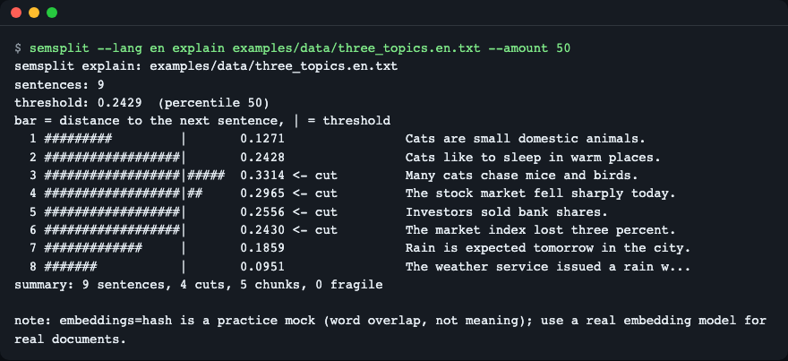
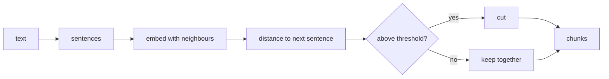
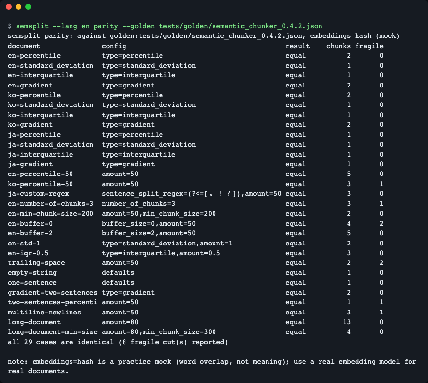
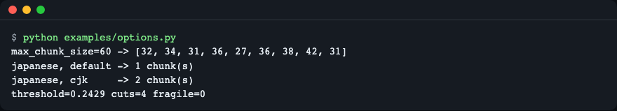
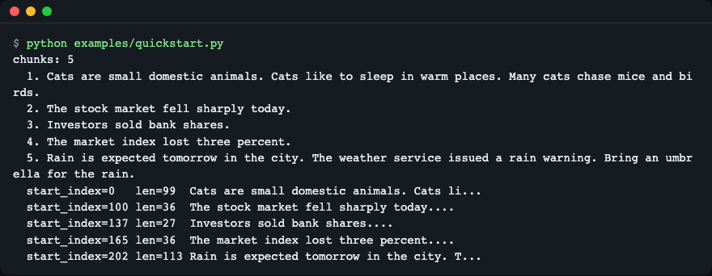

# semsplit

**English** | [한국어](README.ko.md)

Semantic chunking for RAG: a drop-in successor of `SemanticChunker` from the archived `langchain-experimental`. With the default arguments it returns the same chunks, and a parity command lets you check that claim against the original or against recorded output. It depends only on `langchain-core` and `numpy`, and adds opt-in options: a hard maximum chunk size, exact source slices with a correct `start_index`, CJK sentence splitting and embedding batches.



*`semsplit explain` shows the distance to the next sentence as a bar, the threshold as `|`, and every cut.*

## Install

```bash
pip install semsplit
# or with uv
uv add semsplit
# or straight from GitHub
uv add git+https://github.com/LeeGyeongPil/semsplit
```

Python 3.10 or newer. Runtime dependencies: `langchain-core` (1.x) and `numpy`. Nothing else is imported, so the code does not pull in `langchain_community` or `langchain_experimental`.

If you do not have uv: `curl -LsSf https://astral.sh/uv/install.sh | sh` ([docs](https://docs.astral.sh/uv/)). The parity check against the original needs an extra: `pip install "semsplit[legacy]"`.

## Quick start

Moving off `langchain-experimental` is one changed line:

```diff
- from langchain_experimental.text_splitter import SemanticChunker
+ from semsplit import SemanticChunker
```

A runnable example (`HashEmbeddings` is an offline practice mock, see below). The sample file ships with the repository, so run it from a clone of this repository (`git clone https://github.com/LeeGyeongPil/semsplit`); with a pip install, read your own text file instead:

```python
from semsplit import HashEmbeddings, SemanticChunker

text = open("examples/data/three_topics.en.txt", encoding="utf-8").read()
chunker = SemanticChunker(HashEmbeddings(), breakpoint_threshold_amount=50)
for i, chunk in enumerate(chunker.split_text(text), start=1):
    print(i, chunk[:50])
```

```text
1 Cats are small domestic animals. Cats like to slee
2 The stock market fell sharply today.
3 Investors sold bank shares.
4 The market index lost three percent.
5 Rain is expected tomorrow in the city. The weather
```

This is the practice mock mode: `HashEmbeddings` only looks at word overlap, not meaning, so it needs no key and no network. For real documents pass any LangChain `Embeddings` object (OpenAI, Ollama, HuggingFace and so on). The CLI can also use a local Ollama model with `--embeddings ollama:<model>` (reads `OLLAMA_HOST`, default `http://localhost:11434`); that path is only tested against a local fake server, and a real model can be slower.

## Core concepts

1. **Distance between sentences.** The text is split into sentences, each one is embedded (with `buffer_size` neighbours on each side), and the cosine distance to the next sentence is computed.
2. **Threshold.** A cut goes where the distance is above a threshold chosen by `breakpoint_threshold_type` (`percentile`, `standard_deviation`, `interquartile`, `gradient`) and `breakpoint_threshold_amount`.
3. **Fragile cut.** A distance that is almost equal to the threshold. A tiny numeric difference could flip it, so `semsplit` reports these (`--eps` sets "almost").
4. **Parity.** The old and the new code are fed the same vectors, so any difference comes from the splitting code and not from a changing embedding backend.



Each box is one step of `split_text`: split, embed, measure, compare with the threshold, then join what was not cut.

## Usage

### Command line

```bash
uv run semsplit --lang en explain examples/data/three_topics.en.txt --amount 50
```

```text
note: embeddings=hash is a practice mock (word overlap, not meaning); use a real embedding model for real documents.
semsplit explain: examples/data/three_topics.en.txt
sentences: 9
threshold: 0.2429  (percentile 50)
bar = distance to the next sentence, | = threshold
  1 #########         |       0.1271                Cats are small domestic animals.
  2 ##################|       0.2428                Cats like to sleep in warm places.
  3 ##################|#####  0.3314 <- cut         Many cats chase mice and birds.
  4 ##################|##     0.2965 <- cut         The stock market fell sharply today.
  5 ##################|       0.2556 <- cut         Investors sold bank shares.
  6 ##################|       0.2430 <- cut         The market index lost three percent.
  7 #############     |       0.1859                Rain is expected tomorrow in the city.
  8 #######           |       0.0951                The weather service issued a rain w...
summary: 9 sentences, 4 cuts, 5 chunks, 0 fragile
```

Sentence 2 has distance 0.2428 against a threshold of 0.2429: that is the kind of value to watch when you tune a threshold. The number of chunks is always cuts + 1.

`semsplit split FILE` prints one JSON object per chunk (`source`, `chunk`, `start_index`, `text`), for example:

```bash
uv run semsplit --lang en split examples/data/ja.txt --sentence-split cjk --amount 50
```

```text
note: embeddings=hash is a practice mock (word overlap, not meaning); use a real embedding model for real documents.
{"source": "examples/data/ja.txt", "chunk": 0, "start_index": 0, "text": "猫は小さな動物です。猫は暖かい場所で寝ます。"}
{"source": "examples/data/ja.txt", "chunk": 1, "start_index": 22, "text": "今日、株式市場が下落しました。投資家は銀行株を売りました。"}
```

By default `start_index` reproduces the original's value (the sum of the previous chunks' lengths), which can be a character or two off the real position. Pass `--text-mode original` to get exact offsets into the file. An empty or whitespace-only file prints a one-line note on stderr and no chunks.

Screen language: `--lang en|ko`, then `SEMSPLIT_LANG`, then `LC_ALL`, `LC_MESSAGES`, `LANG` (anything that is not Korean falls back to English).

### Check that you get the same chunks (parity)

```bash
uv run semsplit --lang en parity --golden tests/golden/semantic_chunker_0.4.2.json
```

```text
note: embeddings=hash is a practice mock (word overlap, not meaning); use a real embedding model for real documents.
semsplit parity: against golden:tests/golden/semantic_chunker_0.4.2.json, embeddings hash (mock)
document               config                                       result    chunks fragile
en-percentile          type=percentile                              equal          2       0
en-standard_deviation  type=standard_deviation                      equal          1       0
...
long-document-min-size amount=80,min_chunk_size=300                 equal          4       0
all 29 cases are identical (8 fragile cut(s) reported)
```

The 29 cases (English, Korean, Japanese; four threshold types; edge cases such as an empty string and a trailing space) were recorded from `langchain-experimental` 0.4.2 and are checked byte for byte. To compare live with the original on your own files, install the extra:

```bash
uv run --extra legacy semsplit --lang en parity examples/data/three_topics.en.txt examples/data/ko.txt --against legacy --embeddings hash --amount 50
```

```text
note: embeddings=hash is a practice mock (word overlap, not meaning); use a real embedding model for real documents.
semsplit parity: against legacy, embeddings hash (mock)
document               config                                       result    chunks fragile
three_topics.en.txt    amount=50.0                                  equal          5       0
ko.txt                 amount=50.0                                  equal          3       1
all 2 cases are identical (1 fragile cut(s) reported)
```

Exit codes: 0 ok or identical, 1 mismatch (the differing boundary positions are printed), 2 usage or config error (for example a bad `--threshold`), 3 the `legacy` extra is not installed, 4 embedding backend not reachable. Add `--json` for a machine-readable report and `--record FILE` to write your own golden file.



*All recorded cases match.*

### Opt-in options

Defaults reproduce the original, including its quirks. Each option below changes output only when you turn it on (`examples/options.py`):

```python
from semsplit import HashEmbeddings, SemanticChunker, analyze

# 1. Hard size limit: every chunk is at most 60 characters (no extra embedding calls).
sized = SemanticChunker(HashEmbeddings(), breakpoint_threshold_amount=50, max_chunk_size=60)

# 2. Japanese has no spaces between sentences: sentence_split="cjk" splits at 。！？
cjk = SemanticChunker(HashEmbeddings(), breakpoint_threshold_amount=50, sentence_split="cjk")

# 3. Look inside: distances, threshold and the fragile cuts.
info = analyze(text, HashEmbeddings(), breakpoint_threshold_amount=50)
```

```bash
uv run python examples/options.py
```

```text
max_chunk_size=60 -> [32, 34, 31, 36, 27, 36, 38, 42, 31]
japanese, default -> 1 chunk(s)
japanese, cjk     -> 2 chunk(s)
threshold=0.2429 cuts=4 fragile=0
```



*Size limit, CJK splitting and `analyze` on the sample files.*

Exact source slices and `start_index` (`examples/quickstart.py`):

```bash
uv run python examples/quickstart.py
```

```text
chunks: 5
  1. Cats are small domestic animals. Cats like to sleep in warm places. Many cats chase mice and birds.
  2. The stock market fell sharply today.
  3. Investors sold bank shares.
  4. The market index lost three percent.
  5. Rain is expected tomorrow in the city. The weather service issued a rain warning. Bring an umbrella for the rain.
  start_index=0   len=99  Cats are small domestic animals. Cats li...
  start_index=100 len=36  The stock market fell sharply today....
  start_index=137 len=27  Investors sold bank shares....
  start_index=165 len=36  The market index lost three percent....
  start_index=202 len=113 Rain is expected tomorrow in the city. T...
```



*Five chunks, then the same text with `text_mode="original"` and `max_chunk_size=120`; the script asserts `text[start:start+len] == chunk`.*

## API

| Name | What it does | Main arguments | Returns |
|---|---|---|---|
| `SemanticChunker` | Splits text at large embedding distances; a LangChain `BaseDocumentTransformer` | `embeddings`, `buffer_size=1`, `add_start_index=False`, `breakpoint_threshold_type="percentile"`, `breakpoint_threshold_amount`, `number_of_chunks`, `sentence_split_regex`, `min_chunk_size`; keyword-only: `max_chunk_size`, `length_function=len`, `text_mode`, `sentence_split="default"`, `embed_batch_size` | instance |
| `.split_text(text)` | Chunks as strings | `text: str` | `list[str]` |
| `.create_documents(texts, metadatas=None)` | Chunks as `Document`s (`start_index` if enabled) | `texts: list[str]` | `list[Document]` |
| `.split_documents(docs)` / `.transform_documents(docs)` | Same, for `Document`s | `docs` | `list[Document]` / `Sequence[Document]` |
| `.analyze(text, eps=1e-9)` | Distances and cuts without assembling chunks | `text`, `eps` | `Analysis` |
| `analyze(text, embeddings, *, eps=1e-9, **options)` | Same as above in one call | chunker options | `Analysis` (`sentences`, `distances`, `threshold`, `breakpoints`, `fragile`, `chunk_count`) |
| `check_parity(texts, embeddings=None, configs=None, *, against="legacy", eps=1e-9)` | Compare with the original (needs the `legacy` extra) or with a golden file path | see left | `ParityReport` (`all_equal`, `to_dict()`) |
| `record_golden(texts, path, embeddings=None, configs=None, *, embeddings_name="hash", source="legacy")` | Write a golden file | see left | `dict` |
| `HashEmbeddings(dim=256)` | Offline practice mock (word overlap, not meaning) | `dim` | `Embeddings` |
| `ReplayEmbeddings(inner)` | Embeds each distinct text once and replays it | `inner` | `Embeddings` |
| `OllamaEmbeddings(model, host, timeout)` | Optional local Ollama backend | `model`, `host="http://localhost:11434"` | `Embeddings` |
| `BreakpointThresholdType` | Type of the four threshold names | | `Literal` |

Errors, all subclasses of `SemsplitError`: `InvalidConfigError` (bad argument), `LegacyNotInstalledError` (parity without the extra), `EmbeddingBackendError` (backend unreachable).

Options in short:

- `text_mode`: `"legacy"` joins sentences with one space (old behaviour, the default for the default splitter). `"original"` returns exact slices of the source, keeps newlines, never returns empty chunks and applies `min_chunk_size` to the last chunk too. `None` (default) picks `"original"` when `sentence_split` is not `"default"`.
- `max_chunk_size` is measured by `length_function` (default `len`; a word counter works too). Over-long chunks are re-cut at the largest distance inside them, and a single sentence longer than the limit is cut as well.
- `sentence_split`: `"default"`, `"cjk"`, or a callable `text -> [(start, end), ...]`.
- `embed_batch_size`: call `embed_documents` with at most this many texts at a time.

## When to use it

- Use it when you already depend on `SemanticChunker` from `langchain-experimental` and want the same chunks without that package, or when you need a size limit, exact offsets or Japanese and Chinese sentence splitting.
- Other tools: for fixed-size or structure-aware splitting, see [langchain-text-splitters](https://github.com/langchain-ai/langchain/tree/master/libs/text-splitters). For the original implementation, see [langchain-experimental](https://github.com/langchain-ai/langchain-experimental) (archived).
- Scope: `semsplit` splits one text at a time; it does not store vectors or retrieve anything.

### Compared with Chonkie and LlamaIndex

Facts checked on 2026-11-19 from the projects' own pages: [Chonkie docs](https://docs.chonkie.ai/oss/chunkers/semantic-chunker), [LlamaIndex node parsers](https://developers.llamaindex.ai/python/framework/module_guides/loading/node_parsers/modules/), [semchunk](https://github.com/isaacus-dev/semchunk), [semantic-text-splitter](https://github.com/benbrandt/text-splitter).

- **Chonkie `SemanticChunker`** uses a fixed similarity threshold with Savitzky-Golay smoothing, a token-based `chunk_size` and its own chunk and embedding interfaces. Pick it if you already use Chonkie or want token-sized chunks out of the box. Its algorithm differs from the LangChain one, so it cannot reproduce old `SemanticChunker` output; `semsplit` exists for that case.
- **LlamaIndex `SemanticSplitterNodeParser`** uses the same percentile idea but returns LlamaIndex `Node`s, has no maximum size and documents its sentence regex as mostly for English. Pick it inside a LlamaIndex pipeline.
- **semchunk and semantic-text-splitter** are named "semantic" but split by structure (paragraphs, sentences) within a token limit and do not use embeddings. They are a better fit when you only need a size limit and no meaning-based cuts.

## Limitations

- `HashEmbeddings` counts word overlap, not meaning. It is for practice and tests only.
- The Ollama path (`--embeddings ollama:<model>`) was tested only against a local fake server; no real model was evaluated.
- `SemanticChunker` is a LangChain `BaseDocumentTransformer`, not a `TextSplitter` subclass, so it has no `chunk_size` argument or `TextSplitter` helpers.
- There is no native async: `atransform_documents` runs the sync path in an executor. Real async embedding is not implemented yet.
- `text_mode="original"` ignores a subclass override of `_get_single_sentences_list`, because it needs character offsets.
- When `number_of_chunks` equals the number of distances, the original's behaviour is kept: one cut fewer than asked.
- When distances rise monotonically toward one end, the `max_chunk_size` re-split can still be slow.
- Argparse's built-in messages follow the Python locale, not `--lang`.
- Output of the original package can differ near the threshold. The original computes cosine similarity through `langchain_community`, which takes a float32 `simsimd` path when `simsimd` is installed; `semsplit` always uses float64 `numpy`. A cut whose distance is within `--eps` of the threshold (the `fragile` column) could flip. Check on your own files with `semsplit parity --against legacy` and watch that column.

## Troubleshooting

- **`parity --against legacy` exits with 3.** The original package is not installed. Run it with `uv run --extra legacy ...` or `pip install "semsplit[legacy]"`.
- **A threshold seems to be ignored.** `number_of_chunks` overrides the threshold type. When it equals the number of distances, the original's behaviour is kept: one cut fewer than asked.
- **Everything ends up in one chunk.** The short sample documents have few sentences, so a percentile of 95 (the default) cuts almost nothing. Try `--amount 50` and look at `explain`.
- **Argparse messages are not translated.** Its own built-in messages follow the Python locale, not `--lang`.

## Versions and compatibility

- Semantic Versioning. While the version is 0.x, a minor release may change the API; changes are listed in [CHANGELOG.md](CHANGELOG.md).
- Compatible with `langchain-experimental` 0.4.2 default output (29 recorded cases) and `langchain-core` 1.x.
- The algorithm comes from Greg Kamradt's "5 Levels Of Text Splitting" notebook; see [NOTICE](NOTICE). "LangChain" is a trademark of its owners; this project is not affiliated with them.

## Development

```bash
uv sync
uv run pytest -q
```

Tests run offline. `uv run --extra legacy pytest -q -m legacy` runs the live comparison with the original.

## License

MIT, see [LICENSE](LICENSE). Credits: the algorithm comes from Greg Kamradt's "5 Levels Of Text Splitting" notebook and the original `SemanticChunker` in `langchain-experimental` (MIT); see [NOTICE](NOTICE).
